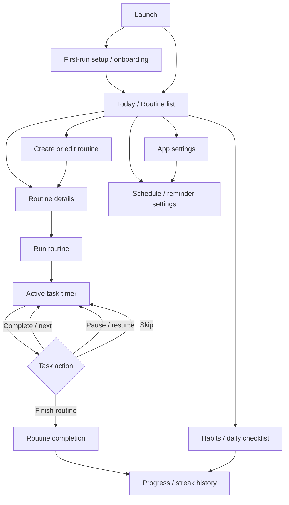

# Core Screen and Navigation Map — Routinery 3.30.0

**Project:** GoodMorning-Lite  
**Date:** 2026-10-14  
**Reference package:** `com.alt.goodmorning`, version `3.30.0`  
**Status:** Static-analysis map; not yet verified by tapping through a running installation.

## How to read this map

- **Evidence-backed** means the package strings/resources contain references to the screen or action.
- **Inferred route** means a plausible navigation connection between those references. It is not presented as runtime-confirmed.
- Screens for widgets, social/sharing, AI/chat, accounts/cloud sync, subscriptions/paywalls, advertising, attribution and analytics are deliberately excluded from the clone, even though some are present in the reference package.

## Proposed core navigation

The exact original bottom-tab order and labels are not yet confirmed. Static strings refer to a **Routine tab** and a **Profile tab**; the latter also contains settings/support and account-related routes that GoodMorning-Lite will not reproduce.

This is the **recommended GoodMorning-Lite navigation model**, based on package evidence and the agreed reduced scope. It is not a claim that every arrow or screen has been observed in the original app.

## Screen-by-screen map

| ID | Screen | Purpose and expected controls | Entry / exit | Evidence and confidence |
|---|---|---|---|---|
| S01 | Launch / first run | Start app; initialise local store; optional setup with skip path | App launch → Today | Onboarding questions and setup strings found. Exact sequence unverified. **Medium** |
| S02 | Today / Routine list | Show routines for today; start a routine; open routine details; create a routine | Launch, routine completion → routine details/editor/timer | Routine-tab and routine-list strings. Layout/tab order unverified. **Medium** |
| S03 | Routine details | Routine name, ordered tasks, total/estimated duration, schedule, start action, edit action | From routine list → active timer/editor | Routine/task/start strings. Exact standalone details screen unverified. **Low–medium** |
| S04 | Create/edit routine | Name routine; add, remove, reorder tasks; set task durations; select schedule/reminder | From list/details → details or list | Create/edit/add-task/reorder strings. **Medium** |
| S05 | Active routine / task timer | Current task, countdown/elapsed time, next task, pause/resume, skip, finish/exit | Start routine → next task/completion | Start timer, task completion, continue/skip and timer wording. **High** that the flow exists; controls/layout need runtime check |
| S06 | Routine completion | End-of-routine result, completed tasks and elapsed time; return to list/progress | Finish active routine → Today/progress | Completion and routine history/streak wording. Exact completion page unknown. **Medium** |
| S07 | Habits / daily checklist | View habits, mark done, review daily completion | Today → progress | Habit/checklist/completion strings. May be integrated into a routine or a separate screen. **Low–medium** |
| S08 | Progress / streaks | Review routine history, streaks and locally calculated summaries | From Today/completion → Today | Streak-day rules and analysis/insight strings. Exact chart layout unknown. **Medium** |
| S09 | Schedule / reminder settings | Choose days/times; choose push-style reminder or alarm behaviour; enable notifications | Routine editor or settings → previous screen | Push/alarm settings, exact-alarm and notification troubleshooting strings. **High** that reminder configuration exists; route unknown |
| S10 | App settings | Basic preferences, notification options, perhaps appearance and data management | Main navigation/settings entry → previous screen | Settings and profile-tab strings. Exact settings list unknown. **Low–medium** |

### Reference-app routes that are intentionally not cloned

- Login, sign-up, profile identity, account management and cloud sync.
- Subscription, premium, paywall, purchase and restore-purchase pages.
- AI analysis/chat and image-based AI flows.
- Friends, public routines, social and sharing.
- Widgets and quick-launch shortcuts.
- Advertising, attribution and analytics SDK screens/flows.

Where the reference app mixes a core function with an excluded area, implement only the local core function. For example, show local progress rather than an AI analysis upsell; never route users to a paywall.

## Core user journeys

### Journey A — Create and run a routine

1. Open Today / Routine list.
2. Tap **Create routine**.
3. Enter a name and add tasks.
4. Set each task duration and order.
5. Optionally choose schedule/reminder settings.
6. Save and open the routine.
7. Tap **Start**.
8. During execution, complete/advance, pause/resume or skip tasks.
9. Finish the routine and save its completion record.
10. Return to Today and update streak/progress locally.

### Journey B — Complete a habit

1. Open Today / Habits.
2. View today's scheduled habits.
3. Mark a habit complete.
4. Save the date and completion state locally.
5. Update streak/progress.
6. Allow the user to undo or correct a mistaken completion.

Whether habits are a distinct original tab or embedded in routine tasks needs runtime verification. The clone can keep them clearly accessible without adding extra top-level tabs unless screenshots indicate otherwise.

### Journey C — Receive a reminder

1. Set a routine schedule.
2. Choose reminder time and reminder style.
3. Request notification permission only when needed.
4. Schedule a local notification/alarm.
5. Open the routine from the reminder.
6. Reschedule after edits or reboot if the feature is implemented.

Exact alarms should only be used when required for the chosen behaviour and allowed by the Android version. A notification is not guaranteed to be delivered at an exact time on every device.

### Journey D — Review progress

1. Finish a routine or mark habits.
2. Store completion timestamps and outcomes locally.
3. Open Progress / History.
4. Calculate streaks and simple summaries from local records.
5. No login, cloud sync, analytics telemetry or AI service is involved.

## Navigation and UI implementation guidance

- Keep the initial navigation shallow: Today, routine editing, active timer, habits/progress, and settings.
- Prefer a single clear primary action on Today: start a routine or create one.
- Preserve routine task order and duration across app restarts.
- Make the timer state explicit: current task, remaining time, paused/running state and next action.
- Do not make a network connection a prerequisite for core screens.
- Do not create empty navigation placeholders for excluded features.
- Persist edits and completions immediately to local storage.
- Handle notification permission denial gracefully; routines and timers should still work.

## Verification checklist for the next runtime pass

The following still require an actual app session and screenshots:

- [ ] First-run screen sequence and whether onboarding can be skipped.
- [ ] Exact main tabs, tab order, labels and icons.
- [ ] Whether habits have a separate screen or live inside routines.
- [ ] Whether routine details is a separate screen or an expanded card.
- [ ] Exact task-timer controls and transition animations.
- [ ] Completion screen and how routine history is reached.
- [ ] Exact reminder options and permission prompts.
- [ ] Empty states, edit/delete confirmations and error states.
- [ ] Screenshots at a known device resolution for spacing, colors, fonts and component styling.

## Source and confidence

This map is based on static strings and metadata from the supplied XAPK plus the agreed GoodMorning-Lite scope. String presence supports the existence of a feature family but does not establish screen hierarchy, runtime route order, or backend requirements. Do not treat the inferred arrows above as observed facts. Update this document after a runtime walkthrough.
